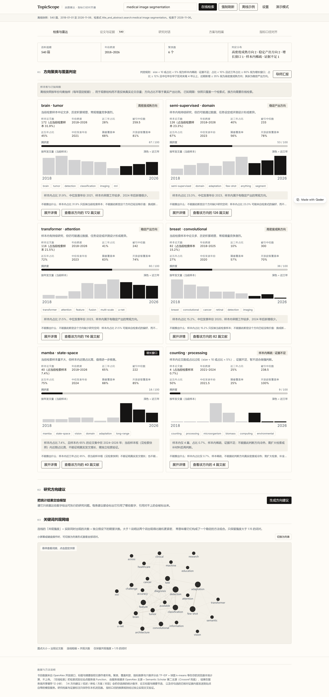
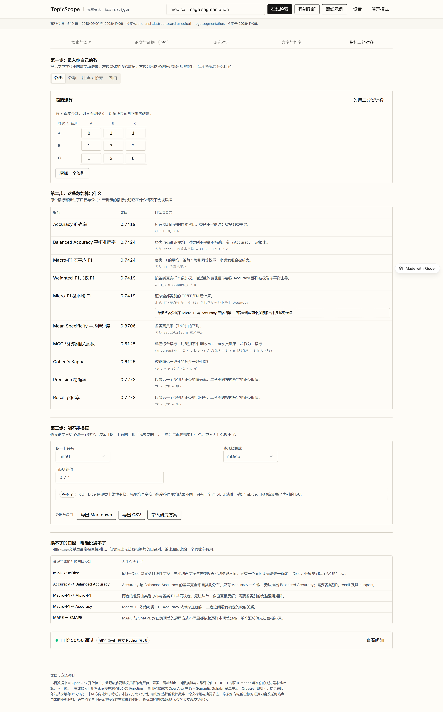
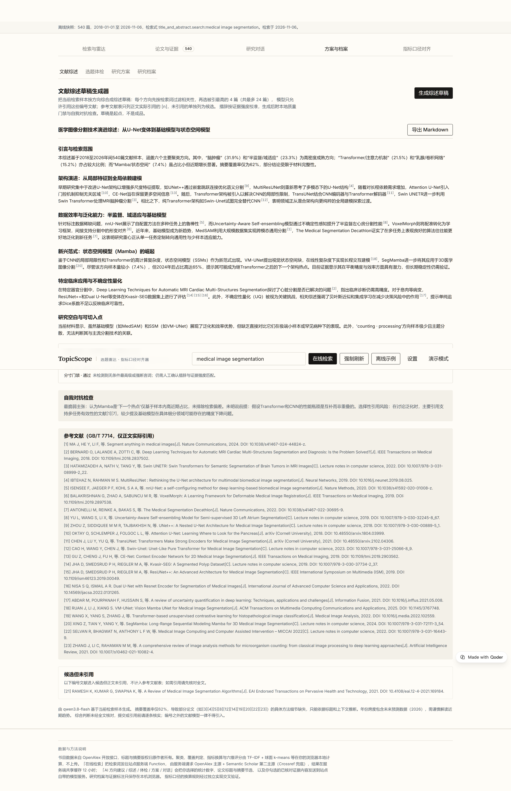
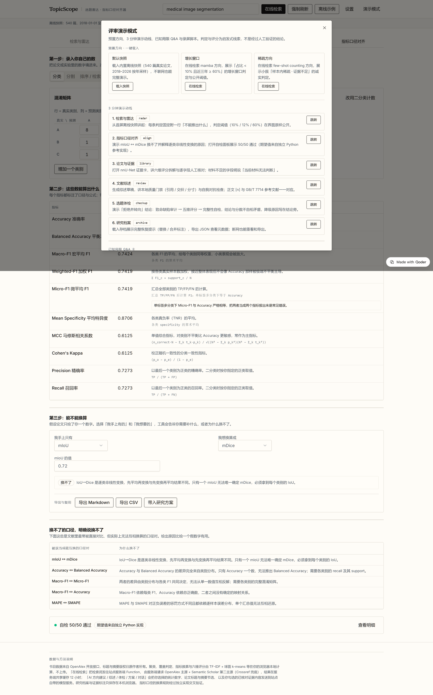

# TopicScope · 选题雷达

给正在读文献、写综述的学生和科研新人的**科研选题工作台**：看清一个方向已经被做透到什么程度，把口径不一的指标换算成可比的数字，并把判断整理成可回查的综述、选题体检与研究方案。分析计算全部在浏览器本地，在线检索与 AI 生成走同源 Edge Function。

- 公网地址：<https://topicscope-piwbj3lryn1.qoder.zone>
- 2026 Qoder 高校创造力大赛 · StudyHack 学习科研赛道参赛作品（[作品帖](https://tianchi.aliyun.com/forum/post/1094982)）
- 技术栈：React 19 + TypeScript + Vite 8 + Tailwind CSS 4（shadcn/ui 组件目录），部署于 Qoder Sites（SPA + Edge Function）

**English**: TopicScope is a research-topic workbench for students writing literature reviews and proposals. It clusters a retrieved paper sample into research directions with an explicit saturation verdict (and an explicit "what this cannot conclude"), converts incomparable metric definitions (mIoU / mDice / accuracy / F1 …) with formulas or a stated mathematical reason why they cannot be inter-derived, and generates evidence-grounded literature reviews, topic feasibility checkups and 15-section research proposals. Every AI citation and number is checked back against the sample; unlocatable references are labelled instead of hidden.

关键词：科研选题 / 选题雷达 / 文献综述生成 / 开题报告 / 研究方案 / 指标口径对齐 / 文献计量 / 方向饱和度 / 证据可回查 · research topic selection, literature review generator, research proposal, metric alignment, bibliometrics, literature mapping, evidence-grounded AI.

## 功能页签

| 页签 | 做什么 |
| --- | --- |
| 方向雷达 | 文献聚类 + 五档覆盖判定（每条判定附「不能推出什么」）、按年趋势、关键词共现图、导师汇报（规则生成）、AI 方向建议（证据 ID 可回查） |
| 指标口径对齐 | 分类 / 分割 / 排序检索 / 回归四类任务、26 个指标的公式与误读提示、口径换算台（换不了的明确说换不了）、内置 50 项自检面板 |
| 文献库 | 按方向筛选、排序、六维候选评分、证据等级标注、论文证据卡（逐字段人工核对）、导出 Markdown / CSV |
| 文献综述 | 基于当前样本生成综述草稿，[n] 引用对应 GB/T 7714 参考文献，本地质量门禁（引用 / 交织 / 分寸）+ 自我对抗检查 |
| 选题体检 | 致命缺陷审计 → 生命周期匹配 → 五维评分 → 范式探测 → 风险 → 三档结论，前端完整性自检防止结论与分数自相矛盾 |
| 研究方案 | 按用户约束生成 15 节方案 + 五项评分 + 逻辑链自洽检查，资源可得性登记，导出 Markdown |
| 研究档案 | 会话存档（IndexedDB）：保存 / 载入 / 合并 / 导入导出，断网可重看 |

当前为五组主导航：检索与雷达 / 论文与证据 / 研究对话 / 方案与档案（内嵌 文献综述·选题体检·研究方案·研究档案 四个子页）/ 指标口径对齐。上表按功能模块列出，与导航分组对应。右上角「演示模式」（`components/DemoGuide.tsx`）内置三个预置方向、3 分钟评审动线一键跳转、已知局限 Q&A 与录屏脚本导出。

## 界面截图

| 方向雷达与覆盖判定 | 指标口径对齐与自检 |
| --- | --- |
|  |  |

| 综述质量门禁 | 评审演示模式 |
| --- | --- |
|  |  |

更多截图与作品帖文案见 `docs/post-assets/`（含 6 张开发过程对话摘录证据图，已对密钥打码）。

## 架构

数据流：检索（`lib/data`）→ 本地分析（`lib/analysis`）→ 指标换算（`lib/metrics`）→ AI 生成（`lib/ai` + 同源 Function）→ 存档（`hooks`）。

- **`src/`**：入口。`main.tsx`、`App.tsx`（页签编排与全局状态接线）、`globals.css`。路径别名 `@` 指向项目根目录，`components/`、`hooks/`、`lib/` 都在根下。
- **`components/`**：UI 层。各页签视图（RadarView / AlignView / LibraryView / ReviewGenerator / FeasibilityChecker / PlanGenerator / SessionArchive 等）、证据卡与共现图，`ui/` 为 shadcn 基础组件。
- **`hooks/`**：状态层。`useCorpus`（检索 + 分析流水线）、`useEvidenceStore`（证据标注，localStorage）、`useSessionStore`（研究档案，IndexedDB）、`useScoreContext`（评分拆解）、`useFunctionProbe`（AI 服务状态探测）。
- **`lib/data/`**：检索适配。`retrieval.ts` 主流程为 本地缓存（同一检索词 12 小时）→ 站点服务端 Function（OpenAlex 主源与 Semantic Scholar 第二主源**并行请求后合并去重**，OpenAlex 不可用才降级 Crossref，服务端共享缓存 12 小时）→ 浏览器直连 OpenAlex/Crossref 仅作兜底；另有去重、DOI 归一、相关性过滤、离线快照加载与类型。
- **`lib/analysis/`**：分词 → TF-IDF → 球面 k-means（固定种子可复现）→ `radar.ts` 聚类与覆盖判定；`cooccurrence.ts` 共现图（lift 筛选）；`scoring.ts` 六维评分；`advisorReport.ts` 规则生成的导师汇报。
- **`lib/metrics/`**：26 个指标的实现与口径注册表、换算规则与「不可互推」清单；`selfcheck.ts` 50 个自检用例，期望值由独立 Python 参考实现（`dev/selfcheck_reference.py`）算出，不共用代码路径。
- **`lib/ai/`**：四个生成器 `directions` / `review` / `feasibility` / `plan`。负责构造发送载荷（统计数字 + 证据 ID 白名单 + 编号文献）、客户端解析与校验（`parseSuggestions` / `parseReview` / `parseFeasibility` / `parsePlan`）、证据回查、综述质量门禁、体检完整性自检与 Markdown 导出；`grounding.ts` 做正文数字与统计白名单的逐条回查。
- **`functions/handler.ts`**：站点唯一后端（Deno Edge Function，`index.ts` 为部署入口）。动作白名单：`search`（GET，双主源并行检索 + 12h 共享缓存）/ `directions` / `review` / `feasibility` / `plan` / `chat` / `status`（GET 探测配置与上游鉴权状态）。模型 key 与检索 key 只从服务端环境变量读取；输入做形状校验、证据 ID 白名单过滤；模型动作同 IP 限流 20 次 / 10 分钟 + 单实例日预算 400，检索同 IP 30 次 / 10 分钟；请求体上限 96 KB，上游超时 60 秒（检索 15–20 秒）。

## 数据与隐私

- **分析全部在浏览器本地**：聚类、覆盖判定、共现、评分、指标换算不上传任何文献内容。
- **在线检索**把检索词发往站点服务端 Function，由服务端**并行**请求 OpenAlex 主源与 Semantic Scholar 第二主源，回来后按 DOI/标题合并去重（OpenAlex 不可用才降级 Crossref），服务端共享缓存 12 小时；命中缓存时不重复请求上游。
- **AI 生成**（方向建议 / 综述 / 体检 / 方案）把统计数字、论文标题与摘要节选、以及你勾选的已核对证据，经同源 Function 发送到站点自带的模型服务；模型 key 不在前端。
- **本机存储**：研究档案存 IndexedDB（`topicscope`），证据标注、检索缓存、可选 OpenAlex key 存 localStorage。
- 服务端 Secret 不进入站点代码、构建产物或任何响应。

## 配置

| 配置 | 位置 | 说明 |
| --- | --- | --- |
| `QWEN_API_KEY` | 服务端 Secret，在 Qoder Sites 站点设置里填写 | AI 功能必需。未配置时前端按 `status` 探测显示原因，本地功能照常可用 |
| `QWEN_MODEL` | 服务端环境变量，可选 | 默认 `qwen3.8-flash` |
| `QWEN_BASE_URL` | 服务端环境变量，可选 | 缺省按一组可信的千问兼容地址依次尝试 |
| OpenAlex API key | 站点服务端 Secret `OA_API_KEY`（站点设置里配置） | 服务端默认使用，访客无需自备 key |
| Semantic Scholar API key | 站点服务端 Secret `S2_API_KEY`（站点设置里配置） | 第二主源合并摘要/开放全文。带 key 走专属速率 1 次/秒（全端点累计），服务端串行化请求保证间隔；未配置时退回匿名共享池，429 退避重试一次后降级为仅主源 |

## 本地运行

Node 版本要求 `^22.13.0 || >=24.0.0`。

```sh
npm install
npm run dev        # Vite 开发服务器（127.0.0.1）
npm run build      # tsc --noEmit + scripts/build.mjs（强制 production 的 Vite 构建）→ dist/
npm run preview    # 本地预览构建产物
```

AI 功能的本地联调需要 [Deno](https://deno.com)：

```sh
npm run dev:function    # deno run --allow-net=127.0.0.1:8000 dev/function-local.ts
npm run check:function  # deno check functions/index.ts
```

本地 Function 监听 `127.0.0.1:8000`，Vite dev / preview 已把 `/functions/v1/app` 代理过去。没有 Deno 时前端照常开发构建，AI 面板按探测结果降级为说明文案，检索、雷达、指标、文献库、档案不受影响。

## 测试与自检

```sh
node_modules/.bin/jiti dev/run-selfcheck.ts   # 指标自检，输出「自检 50/50 通过」，失败时退出码非 0
node_modules/.bin/jiti dev/run-analysis.ts    # 在离线快照上跑聚类与共现的冒烟检查
```

- 自检期望值来自 `dev/selfcheck_reference.py` 的独立实现（只共享数学定义），页面「指标口径对齐」里也内置同一份自检面板。
- `dev/fetch-snapshot.ts` 用于重抓离线快照（需环境变量 `OPENALEX_API_KEY`，产物不含 key）。

## 验证

**已做的自动化验证**（`npm run regression`，即 `node scripts/regression.mjs`，共 348 条断言，全程不触网、不改源文件）：

- **判定阈值稳定性回归**：对增长窗口 / 高密度成熟的判定阈值（10% / 12% / 60%）做 ±20% 扰动，在同一批稀疏簇夹具上重跑判定，稀疏簇不翻转（翻转 0 次），并断言 6/6 组扰动确实生效（非空跑）。
- **指标换算交叉验证**：50 项自检的期望值由独立 Python 参考实现（`dev/selfcheck_reference.py`）算出，与 TypeScript 实现只共享数学定义、不共用代码路径，50/50 通过。
- **本地门禁**：综述 / 体检 / 方案每次生成后都在前端本地跑校验——综述质量门禁（引用 / 交织 / 分寸）、体检完整性自检（结论与分数矛盾时自动降级）、方案解析与证据白名单；其中综述门禁、方案解析与正文数字回查已纳入回归断言。
- **服务端检索回归**：esbuild 打包自包含 handler + 按 hostname 分发的上游 mock，断言双主源并行发起、S2 带 `x-api-key` 且相邻请求 ≥1.1 秒、429 退避重试一次后仅主源、请求成功但 0 命中不报故障、OpenAlex 故障才降级 Crossref 且按检索词过滤、12h 共享缓存与 refresh 绕过、导出头部检索快照元数据。

**未做的验证（诚实口径）**：

- 未做人工金标准标注，未报告聚类纯度 / ARI，也没有判定与专家标注的一致率。
- 在线检索为偏向性抽样（按检索式相关度返回，快照按年分桶采样），未与 OpenAlex 全量年度计数对比；样本占比不等于领域真实产出比例。
- 因此覆盖判定、评分权重与体检结论仍是**启发式线索，不是经过人工验证的结论**。回归保证的是「实现与公开规则一致、阈值扰动下稳定」，不能证明规则本身正确。

## 部署（Qoder Sites）

1. `npm run build` 产出 `dist/`。
2. 通过 Sites 工具 prepare：`webDirectory: "dist"`、`spa: true`、`functionDirectory: "functions"`、`secretNames: ["QWEN_API_KEY", "OA_API_KEY", "S2_API_KEY"]`。
3. publish 发布，并在站点设置里填入服务端 Secret `QWEN_API_KEY` / `OA_API_KEY` / `S2_API_KEY`；访问权限设为任何人可访问。

`.gitignore` 已忽略 `dist/`、`.env*`、`.qoder-sites/`、`.tmp/` 等，密钥与产物不入库。

## 目录结构

```
├── src/                  # 入口：main.tsx / App.tsx / globals.css
├── components/           # 页签视图与 ui/ 基础组件
├── hooks/                # 语料、证据、档案、评分、服务探测等状态
├── lib/
│   ├── data/             # OpenAlex / Crossref 适配、缓存、去重、快照
│   ├── analysis/         # 分词、TF-IDF、k-means、判定、共现、评分
│   ├── metrics/          # 26 指标、换算注册表、50 项自检
│   ├── ai/               # 四个生成器的载荷、解析校验与导出
│   └── api.ts 等         # 同源 Function 调用封装与工具
├── functions/            # Edge Function：handler.ts + index.ts（Deno）
├── dev/                  # 本地脚本：自检、分析冒烟、快照抓取、Function 联调
├── scripts/              # check-node.mjs / build.mjs
├── public/data/          # 离线快照（540 篇真实论文，2018–2026 按年采样）
├── docs/                 # 作品帖文案与设计稿
└── vendor/               # 上游 shadcn CSS 及其许可证
```

## 许可与署名

- 选题体检框架、综述写作纪律、方案逻辑链检查、审稿人速查改编自 [HKUSTDial/Supervisor-Skills](https://github.com/HKUSTDial/Supervisor-Skills)（**CC-BY-4.0**），界面与导出 Markdown 中均保留署名；改编做了简化，不等同于原项目的完整评估。
- UI 基础来自 Qoder Sites React starter，见 `PROVENANCE.md`；`vendor/` 保留上游样式许可证。
- 书目数据来自 OpenAlex / Crossref 开放接口，标题与摘要版权归原作者所有。
- 覆盖判定、评分权重与体检结论均为启发式线索，不是同行评议结论；边界说明见站点页脚与作品帖。
